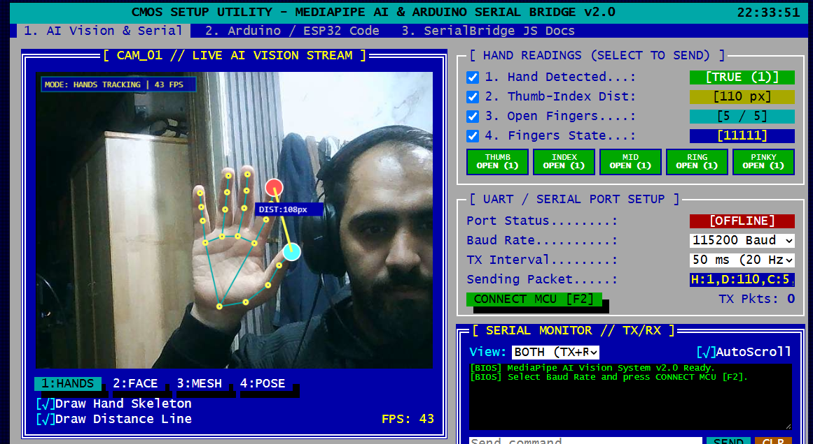
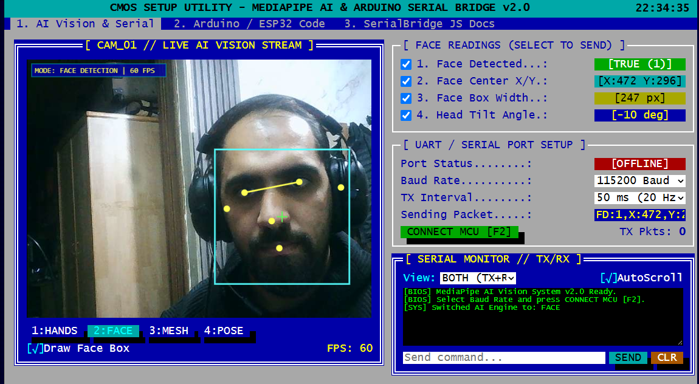
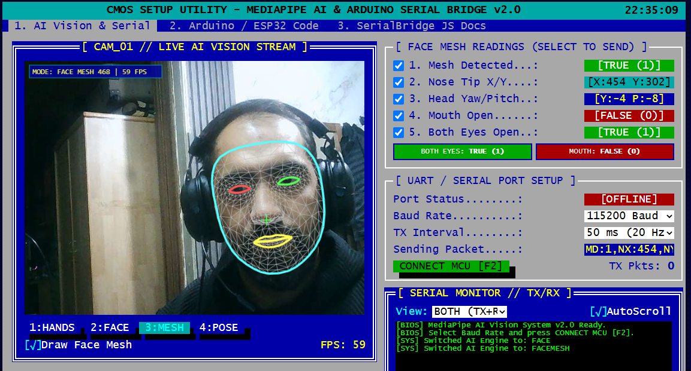
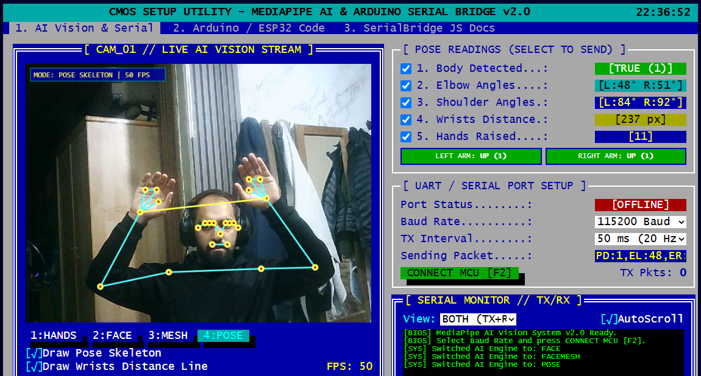
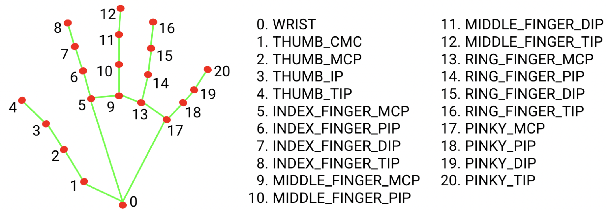

# MediaPipe-MCU-Studio

A browser-based **MediaPipe Computer Vision & Microcontroller Serial Studio** that extracts and stabilizes real-time AI telemetry directly in the browser and streams it to **Arduino, ESP32, ESP8266, or STM32** microcontrollers via the **Web Serial API** (`SerialBridge.js`) — with **zero Python or OpenCV installation required**.

---

## Interface Previews

### 1. Hand Tracking (`1:HANDS`)


### 2. Face Detection (`2:FACE`)


### 3. 468-Point Face Mesh (`3:MESH`)


### 4. Body Pose Skeleton (`4:POSE`)


---

## Key Features

- **Zero-Install Browser Execution:** Runs directly in **Google Chrome** or **Microsoft Edge** using WebAssembly/WebGL MediaPipe models and the native **Web Serial API**.
- **Selective Telemetry Packet Builder:** Check `[X]` next to only the metrics you need to keep your microcontroller's UART buffer fast and clean.
- **Built-in Signal Stabilization:** Integrated **Low-Pass Exponential Moving Average (EMA) + Deadband & Hysteresis filters** eliminate camera jitter and provide rock-solid numbers.
- **Advanced Serial Monitor:** Filter live UART streams by **`BOTH (TX+RX)`**, **`TX ONLY`**, or **`RX ONLY`**, with an **`AutoScroll`** toggle for easy hardware debugging.
- **Ready-to-Use Arduino / ESP32 Sketches:** Dedicated receiver code included for each AI model inside Tab 2 (`2. Arduino / ESP32 Code`).

---

## Supported AI Models & Serial Protocols

### 1. `1:HANDS` (21-Landmark Hand Tracking)
Default Packet Example: `H:1,D:120,C:5,F:11111\n`

| Reading | Serial Key | Example | Description |
| :--- | :--- | :--- | :--- |
| **Hand Detected** | `H` | `H:1` / `H:0` | Boolean (`1` = True, `0` = False) |
| **Thumb-Index Dist** | `D` | `D:120` | Euclidean distance between thumb & index tips (`px`) |
| **Open Fingers** | `C` | `C:5` | Total extended fingers count (`0..5`) |
| **Fingers State** | `F` | `F:11111` | 5-Bit binary state `[Thumb, Index, Middle, Ring, Pinky]` (`1` = Open, `0` = Shut) |



---

### 2. `2:FACE` (Face Bounding Box & Head Roll)
Default Packet Example: `FD:1,X:320,Y:240,W:180,T:-5\n`

| Reading | Serial Key | Example | Description |
| :--- | :--- | :--- | :--- |
| **Face Detected** | `FD` | `FD:1` / `FD:0` | Boolean (`1` = True, `0` = False) |
| **Face Center X/Y** | `X`, `Y` | `X:320,Y:240` | Face center coordinates in pixels (`px`) |
| **Face Box Width** | `W` | `W:180` | Bounding box width / camera proximity (`px`) |
| **Head Tilt Angle** | `T` | `T:-5` | Eye-to-eye roll tilt angle in degrees (`-45°..+45°`) |

---

### 3. `3:MESH` (468-Point 3D Face Mesh)
Default Packet Example: `MD:1,NX:320,NY:240,Y:10,P:-5,M:0,E:1\n`

| Reading | Serial Key | Example | Description |
| :--- | :--- | :--- | :--- |
| **Mesh Detected** | `MD` | `MD:1` / `MD:0` | Boolean (`1` = True, `0` = False) |
| **Nose Tip X/Y** | `NX`, `NY` | `NX:320,NY:240` | Stabilized nose tip coordinates (`px`) |
| **Head Yaw/Pitch** | `Y`, `P` | `Y:10,P:-5` | Horizontal Yaw & Vertical Pitch angles (`deg`) |
| **Mouth Open** | `M` | `M:1` / `M:0` | Boolean (`1` = Open, `0` = Shut) |
| **Both Eyes Open** | `E` | `E:1` / `E:0` | Boolean (`1` = Open, `0` = Closed) |

---

### 4. `4:POSE` (33-Landmark Body Pose Tracking)
Default Packet Example: `PD:1,EL:160,ER:90,SL:45,SR:110,WD:250,AR:01\n`

| Reading | Serial Key | Example | Description |
| :--- | :--- | :--- | :--- |
| **Body Detected** | `PD` | `PD:1` / `PD:0` | Boolean (`1` = True, `0` = False) |
| **Elbow Angles** | `EL`, `ER` | `EL:160,ER:90` | Left & Right elbow flexion angles (`0°..180°`) |
| **Shoulder Angles** | `SL`, `SR` | `SL:45,SR:110` | Left & Right shoulder elevation angles (`0°..180°`) |
| **Wrists Distance** | `WD` | `WD:250` | Distance between Left & Right wrists (`px`) |
| **Hands Raised** | `AR` | `AR:01` | 2-Bit binary `[LeftArm, RightArm]` (`1` = Up, `0` = Down) |

---

## Standalone `SerialBridge.js` Library Usage

You can use `js/serial-bridge.js` in any web project to communicate with Arduino or ESP32 over UART:

```html
<script src="./js/serial-bridge.js"></script>
<script>
  const mcu = new SerialBridge({
      baudRate: 115200,
      sendIntervalMs: 50, // Automatically throttles data to 20Hz
      onStatusChange: (connected, baud) => {
          console.log("Connected:", connected, "Baud:", baud);
      },
      onReceive: (line) => {
          console.log("From Arduino:", line);
      }
  });

  // Connect from a user button click:
  document.getElementById("connectBtn").onclick = () => mcu.connect(115200);

  // Send telemetry or custom commands anywhere in your loop:
  mcu.sendRaw("H:1,D:125,C:5,F:11111");
</script>
```

---

## Project Structure

```text
MediaPipe-MCU-Studio/
├── index.html                          # Main Web Studio Interface (AI Vision + Arduino Sketches + Docs)
├── README.md                           # Project Documentation
├── img/                                # Interface Screenshots & Landmark Reference Diagrams
│   ├── hand.PNG
│   ├── face.PNG
│   ├── MESH.PNG
│   ├── POSE.PNG
│   └── hand-landmarks.png
├── js/
│   ├── serial-bridge.js                # Standalone Web Serial API Library for Arduino/ESP32
│   └── bios-ai-app.js                  # Unified MediaPipe AI Controller & Signal Stabilizer
├── arduino/                            # Ready-to-upload Arduino / ESP32 Sketches
│   ├── 1_HANDS_Receiver/
│   │   └── 1_HANDS_Receiver.ino
│   ├── 2_FACE_Receiver/
│   │   └── 2_FACE_Receiver.ino
│   ├── 3_MESH_Receiver/
│   │   └── 3_MESH_Receiver.ino
│   └── 4_POSE_Receiver/
│       └── 4_POSE_Receiver.ino
└── dist/                               # TuiCss Theme CSS, JS, Fonts & Backgrounds
```

---

## Quick Start

1. Open `index.html` in **Google Chrome** or **Microsoft Edge** (using VS Code **Live Server**, `localhost`, or **GitHub Pages**).
2. Open **Tab 2 (`2. Arduino / ESP32 Code`)**, copy the sketch for your selected model, and upload it to your Arduino or ESP32.
3. Close the Arduino IDE Serial Monitor so the COM port is free.
4. In the web interface, select your **Baud Rate** (`115200`), check `[X]` next to the readings you want to send, and click **CONNECT MCU [F2]**.
